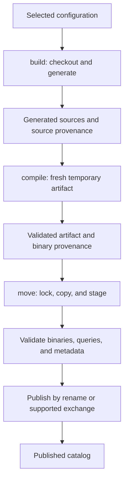

# Architecture and pipeline

`ts-build` separates source generation, compilation, and publication. This separation lets users inspect intermediate results and select artifacts without rebuilding every stage.

## Configuration boundary

The selected YAML file defines grammar repositories, full commit pins, tool versions, targets, paths, and runtime policy.

Normal use selects a per-user configuration. A current-directory `.env` containing `TS_BUILD_ENV=DEVELOPMENT` selects `./tree-sitter-config.yaml`. An explicit `--config` takes precedence.

Relative paths resolve from the configuration directory. The embedded catalog seeds a missing user configuration; it does not overwrite an existing one during upgrades.

The catalog contains 65 entries in this release. The selected user configuration can contain a different set.

## Pipeline boundaries

### Source generation

The builder checks out the configured 40-character revision and invokes the pinned Tree-sitter generator. It records the commit timestamp and source hashes.

A failed existing checkout is preserved unless the user explicitly authorizes removal with `--force`. Generation ABI fallback follows runtime policy; a per-language ABI override disables that fallback.

### Compilation

The compiler verifies generated inputs against source provenance. It builds into a temporary output location rather than accepting an old final artifact after a failed command.

Successful compilation records the artifact checksum and compiler metadata. These checks bind provenance to bytes; they do not authenticate an upstream repository.

### Staging and validation

The mover takes a per-catalog interprocess lock before copying the current catalog into staging. The lock spans recovery, staging, and publication, so concurrent updates do not overwrite each other's catalog changes.

The mover verifies binary checksums and configured source identities. Host validation measures parser ABIs. Foreign validation checks binary structure without measuring an ABI.

Manifest generation requires measured binary metadata. Compact schema generation performs a semantic round-trip check.

## Publication boundary

For a new catalog, publication renames the staged directory into place.

For an existing catalog, publication exchanges the staged and current directories with an operating-system operation. Linux and macOS implementations depend on filesystem support. The implementation does not replace an existing catalog on Windows.

An unsupported exchange fails without removing the current catalog. `--force` authorizes replacement of selected grammar output; it does not enable an unsafe rename fallback.

Recovery preserves the last release. If a legacy `.previous` directory exists without a current catalog, recovery restores it before continuing.

Cancellation is checked before publication and cleanup. Cancellation after a completed publication does not undo that publication.

## Cleanup boundary

Cleanup affects intermediate workspaces, not published grammar output. `move --clean=false` retains the checkout for inspection. Runtime cleanup policy controls full cleanup versus pruning.

A successful publish and a cleanup result are distinct outcomes. Keep workspaces until release inspection is complete if diagnosis requires generated sources.

## Downstream metadata

`manifest.json` serves downstream consumers such as the graph builder. `compact-node-types.yaml` serves AST consumers, including AI agents. Neither file is an internal prerequisite for compiling a parser.

See [Build and release](../how-to/build-and-release-grammars.md), [Dual-mode validation](dual-mode-validation.md), and [Provenance](reproducible-builds-and-provenance.md).
